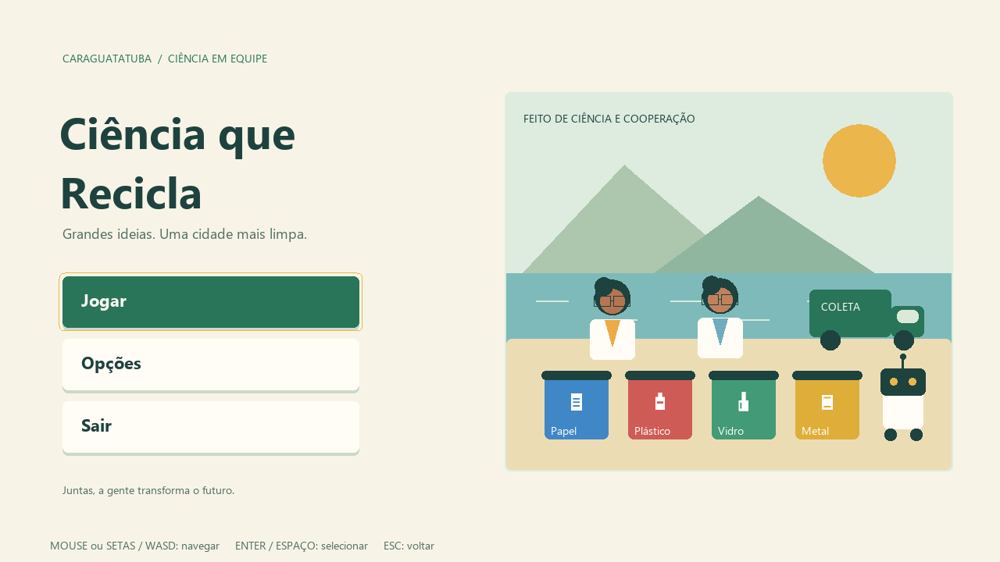

# Ciência que Recicla

Projeto em GML para GameMaker LTS 2026. O nome é provisório. Código, recursos e pastas usam inglês; os textos do jogo usam português brasileiro.

Abra `GameJam2026.yyp` no GameMaker e execute com **F5**. A primeira room deve ser `rm_boot`.

## O que já funciona

- Tela inicial com **Jogar**, **Opções** e **Sair**, com confirmação de saída.
- Seleção de **Solo**, **Co-op Local** e **Co-op Rede**.
- Menus por mouse, setas/WASD e Enter/Espaço. Escape volta; controle com direcional e A/B também é aceito.
- Volume geral, tela cheia e dicas de navegação, salvos em `settings.ini` na área de dados do jogo.
- Preparação de Solo e Local: consulta às quatro cientistas, seleção da fase e acesso à sua apresentação.
- Cinco rooms de fase, com objetivos e metas propostas de 1, 2 e 3 estrelas.
- Ilustração da tela inicial desenhada em GML e quatro sprites provisórios de resíduos.

Esta entrega implementa a estrutura e os menus. **As fases ainda são apresentações, sem gameplay.** Solo e Local chegam à preparação; Rede abre uma tela explicando que a conexão ainda será implementada. Os objetos de coleta, caminhão, robôs e rede têm dados iniciais, sem simulação. Não há áudio ainda; o ajuste de volume já está conectado ao volume geral.

As biografias são propostas ficcionais editáveis, sem atribuir realizações a pessoas reais. As artes são provisórias. As fontes da interface estão incluídas como recursos bitmap com acentos em português; nenhum arquivo de fonte do sistema é necessário na execução.

## Organização

| Pasta | Responsabilidade |
| --- | --- |
| `objects` | Controladores, cientistas, robôs, estações de coleta e rede |
| `scripts` | Configuração, dados, entrada, menus, desenho e preferências |
| `rooms` | Inicialização, menus e cinco fases |
| `sprites` | Resíduos e espaços para personagens, robôs, cenário e UI |
| `sounds` | Espaços para música e efeitos |
| `fonts` | Cinco fontes bitmap da interface, com acentos em português |
| `tilesets`, `shaders`, `sequences`, `paths`, `timelines` | Espaços para recursos futuros |
| `datafiles` | Arquivos externos que futuramente poderão ser incluídos no projeto |
| `docs` | Arquitetura, regras e próximos passos |
| `tools` | Verificação de integridade dos recursos |

As categorias também estão registradas no Asset Browser. As pastas ainda vazias estão reservadas para o desenvolvimento; não contêm recursos fictícios.

## Onde editar

- Textos das cientistas, fases e balanceamento: `scripts/scr_game_data/scr_game_data.gml`.
- Identificadores e constantes: `scripts/scr_game_config/scr_game_config.gml`.
- Botões e navegação: `scripts/scr_menu/scr_menu.gml`.
- Aparência e ilustração: `scripts/scr_ui/scr_ui.gml`.
- Comandos de menu e de futuras jogadoras: `scripts/scr_input/scr_input.gml`.

Verifique as referências com `py tools/validate_project.py`. Essa verificação não substitui a compilação e a execução no GameMaker.

Próximas etapas e regras estão em [docs/game_design.md](docs/game_design.md) e [docs/architecture.md](docs/architecture.md).
